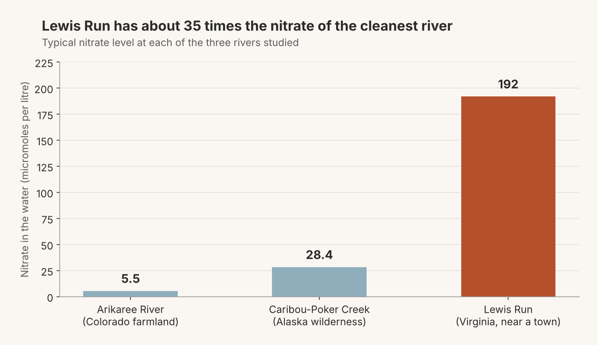

## The problem: testing a river is slow, and pollution doesn't wait

How polluted is a river right now? The traditional answer is old-fashioned. Someone drives out, dips a bottle in the water and posts it to a lab. Days later you get one number, for one moment, at one spot.

That is a problem for **nitrate**. It washes into rivers from fertiliser, livestock waste and city runoff. Too much of it feeds algae blooms and can make water unsafe to drink. Nitrate can swing within a single day with rain, sunlight and the time of day. A sample taken on Tuesday morning says little about Monday night.

Cheap electronic sensors now make it possible to leave a device in a river, logging a reading every 15 minutes all year. The catch is that a sensor only measures what it was built to measure, and nitrate sensors are costly. So researchers asked two practical questions:

1. Can a few cheap, easy-to-measure signals predict nitrate, so we don't need a nitrate sensor everywhere?
2. Does an answer that works on one river also work on a very different one?

## What the researchers did, and what they found

A research team studied three rivers that could hardly be more different. They used open data from the US National Ecological Observatory Network, a government-funded network of environmental sensors [@kermorvant2023]. @tbl-rivers shows the three sites.

| River | Where | What's nearby | Nitrate pollution |
|---|---|---|---|
| Arikaree River | Colorado | Dry farmland | Low |
| Caribou-Poker Creek | Alaska | Untouched wilderness | Medium |
| Lewis Run | Virginia | A town and a wastewater plant | High |

: Three rivers in very different settings, chosen because they were not expected to behave alike {#tbl-rivers}

@fig-nitrate shows how far apart they are. Nitrate at Lewis Run was about 35 times higher than at the cleanest river.

{#fig-nitrate width="90%"}

The team used a statistical method that can follow curved, uneven patterns instead of assuming straight lines. With it they predicted nitrate very accurately. Their predictions captured 99% of the ups and downs at every river. An earlier machine-learning method had managed 89%.

The more interesting result was *what* made the predictions work. The same six easy-to-measure signals were useful at all three rivers:

- electrical conductivity
- dissolved oxygen
- water temperature
- cloudiness
- time of day
- water level

The exact link between, say, temperature and nitrate differed from river to river. The list of what to measure did not.

That answers both questions from the start. A standard, cheap sensor kit can predict nitrate. The same kit works across very different rivers, as long as the model is recalibrated for each one.

## Conclusion: cheap sensors, smart models, healthier rivers

We started with a monitoring gap. Bottle samples are too slow and too sparse to catch a pollutant that changes within hours. The study narrows that gap. Six cheap signals reproduced 99% of nitrate's movement at all three rivers. A standard sensor kit plus a model recalibrated for each river is a realistic substitute where a dedicated nitrate sensor is unaffordable. That matters most to anyone deciding where to spend a monitoring budget.

What the study does not show is just as important. Three rivers cannot cover every pollution source. The predictions were checked against nitrate sensor readings, not laboratory samples, so the 99% describes agreement with another sensor. Each new river also needs its own period of nitrate data to fit the model. The saving comes from sensors that stay in place long term, not from skipping nitrate measurement altogether. Treat the result as strong evidence that the approach is worth trialling, not as proof that it works everywhere.

## A note on this post versus the paper

A journal article and a blog post do different jobs. The article [@kermorvant2023] is built to last. It is stand-alone, so a reader needs nothing else to follow it. It is archival, with a permanent identifier (a DOI) that will still resolve years from now. It is defensible: it was peer reviewed, and it reports the data, model and assumptions in enough detail for other scientists to check and challenge the work. That format has lasted centuries because it lets claims be tested, not just believed.

This post makes the opposite trade. It is quick to read and written for people who will never open a model specification. But it cannot be checked on its own, it carries no review, and it can be edited or removed at any time. That is why it leaves out the model details and points back to the paper. If you plan to rely on any number here, verify it against the article first.
